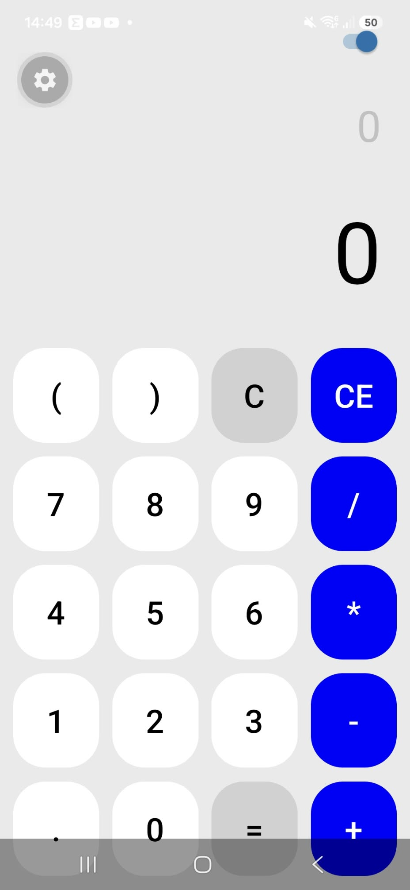
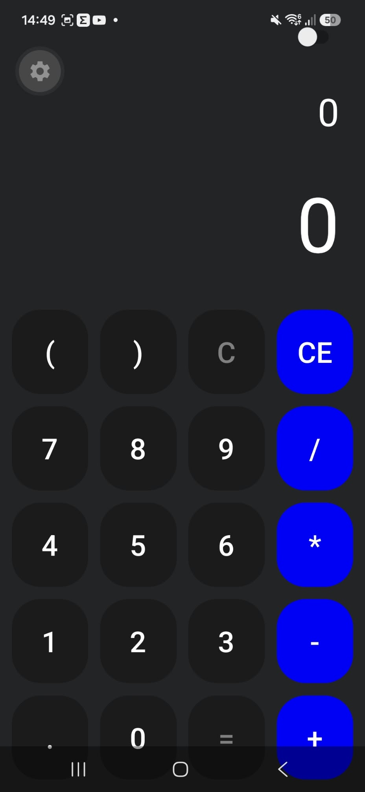
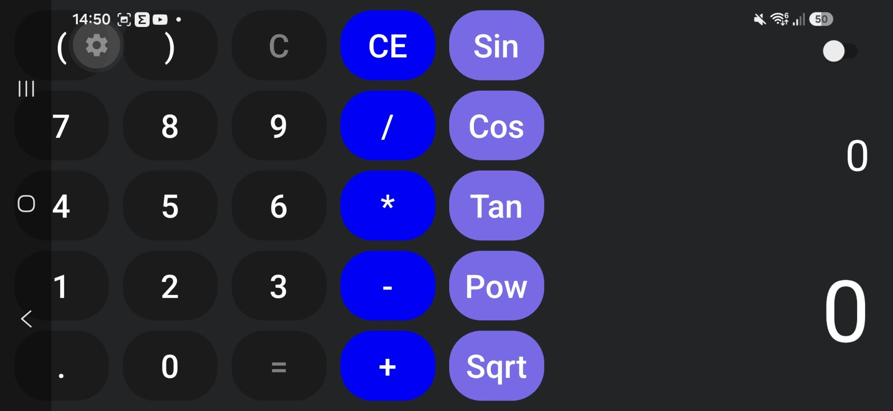
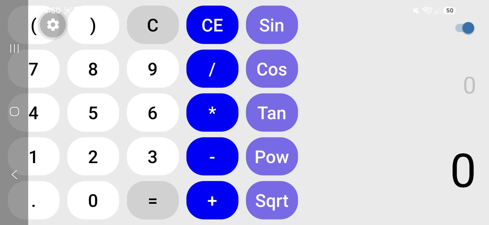
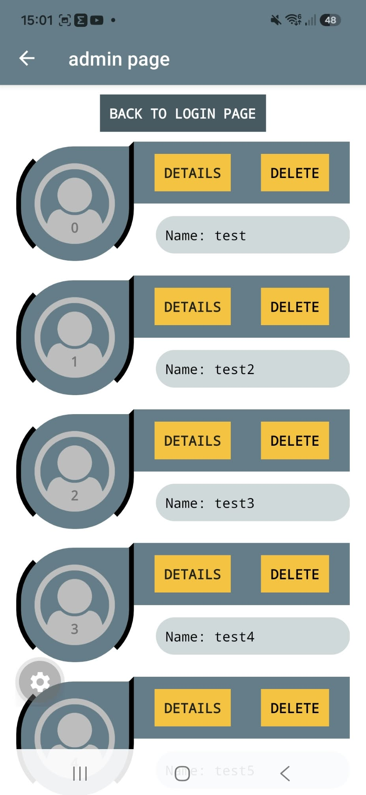
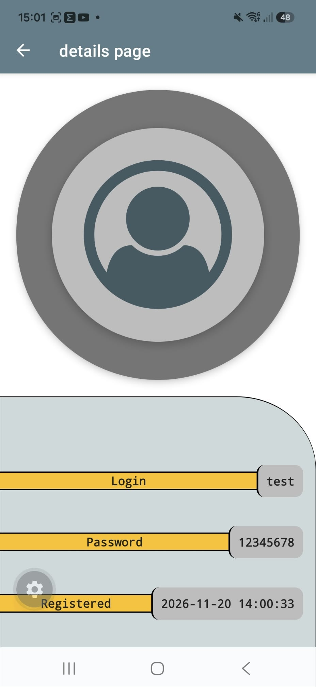

# React Native Apps

Two small mobile apps made with React Native and Expo. (School project)

## Apps

### Calculator (`calculator/`)

- Basic operations plus sin, cos, tan, x² and √
- Input is checked with a regex, so you can't type things like `5++3` or `1.2.3`
- Dark and light theme, follows the phone's setting and can be switched in the app
- Different layout in landscape
- Long numbers get a smaller font so they fit

<p>
  
  
</p>
<p>
  
  
</p>

### Register app (`register-app/`)

- `register/`: the app, three screens with React Navigation
  - register with name and password (the server checks length and if the user already exists)
  - admin page with the list of users, delete and details for each one
  - details page with the login, password and registration date
- `register_server/`: Express server that keeps the users in memory

<p>
  
  
  
</p>

## Stack

React Native, Expo (SDK 58), React Navigation, hooks (`useState`, `useEffect`), `fetch`, Node.js + Express for the server.

## Running it

You need Node.js and the Expo Go app on your phone (or an Android/iOS emulator).

Calculator:

```
cd calculator
npm install
npx expo start
```

Then scan the QR code with Expo Go.

Register app: first put your computer's local IP in `register-app/register/Settings.json` (the phone has to be on the same network), then start the server and the app in two terminals:

```
cd register-app/register_server
npm install
node server.js
```

```
cd register-app/register
npm install
npx expo start
```

## Known limitations

- Calculator uses `eval()` for the result, the `(` and `)` buttons don't do anything and sin/cos/tan use radians
- Register server keeps users in memory and the details page shows the password in plain text

